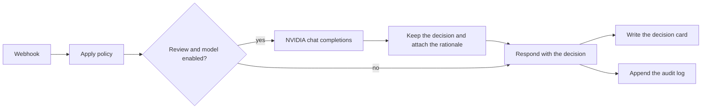

# Payments & Credit Decisioning Workbench

This folder is an importable n8n workflow. It accepts one payment or application event, applies a fixed policy, and returns `approve`, `review`, or `deny`. A review can include a short rationale from NVIDIA. The decision stays with the rules.

Use it to walk a payments API integration and a credit decision flow on one canvas.

## Why this shape

A Stripe solutions engineer spends the session on a PaymentIntent, card checks, risk, and velocity. A Plaid solutions engineer spends it on identity match, income, balance, and NSF counts. A decisioning engineer spends it on reason codes, a policy version, and a model that does not override the policy. This workflow keeps those three checks in one path.

## Flow



The Code node holds the policy. The source file is `engine/decision-engine.mjs`. `scripts/build-workflow.mjs` copies that file into the workflow JSON. Run the build script after you change the policy. The unit test fails when the JSON is stale.

The HTTP Request node calls `POST {NVIDIA_BASE_URL}/chat/completions`. The default base URL is `https://integrate.api.nvidia.com/v1`. The default model is `meta/llama-3.3-70b-instruct`. The node runs only when the decision is `review` and the mode allows a model call. If the call fails, the workflow keeps the mock rationale and records a short fallback reason. The model text never selects the decision.

## Policy `payments-credit-v1`

Stripe amounts are integer cents. Plaid amounts are major units. The engine converts Plaid amounts to cents.

A hard deny wins over every other rule.

| Rule | Result |
| --- | --- |
| Payload is not an object | deny `PAYLOAD_NOT_AN_OBJECT` |
| Source is not `stripe` or `plaid` | review `SOURCE_UNRECOGNIZED` |
| Amount is missing or invalid | deny `AMOUNT_INVALID` |
| KYC status is `failed` | deny `KYC_FAILED` |
| Identity document is `rejected` | deny `DOCUMENT_REJECTED` |
| Stripe risk level is `highest` or score is 80 or more | deny |
| CVC check and AVS check are both `fail` | deny `CARD_CHECKS_FAILED` |
| Failed card attempts in 1 hour are 5 or more | deny `VELOCITY_FAILED_ATTEMPTS` |
| Distinct cards in 24 hours are 4 or more | deny `VELOCITY_CARD_TESTING` |
| Applications in 7 days are 5 or more | deny `VELOCITY_APPLICATIONS` |
| NSF count in 90 days is 5 or more | deny `NSF_COUNT_HIGH` |
| Amount is above the review band and KYC is not `verified` | deny `AMOUNT_ABOVE_LIMIT_UNVERIFIED` |

The review band is 500,000 cents for Stripe ($5,000) and 1,000,000 cents for Plaid ($10,000).

Auto-approve requires every check below. Any miss sends the case to review.

| Check | Stripe | Plaid |
| --- | --- | --- |
| KYC | `verified` | `verified` |
| Amount | up to $500 | up to $1,000 |
| Risk | score 30 or lower, level not `elevated` | not used |
| Card | CVC `pass`, AVS not `fail` | not used |
| Velocity | velocity object present, 0 failures in 1 hour, at most 3 payments in 24 hours, at most 1 card | at most 1 application in 7 days |
| Identity | not used | name match, verified document, verified income, NSF count 0 |
| Balance | not used | available balance is at least half of the requested amount |
| Currency | three-letter code | three-letter code |

The workflow does not keep a payment history. Put the velocity counters on the event before you call the webhook. A warehouse, Stripe Sigma, or your own ledger can fill those fields. This demo only reads them.

The engine masks runs of 13 to 19 digits in the card and in the model prompt. It does not copy the applicant email into the card or the prompt. The card does include the Plaid applicant name from the sample payload.

## Sample results

The clock in `expected/` is fixed at `2026-11-11T12:00:00.000Z`. A live run uses the current time. Compare the decision, the reason codes, and the rationale text.

| Sample | Decision | Reason codes |
| --- | --- | --- |
| `stripe-approve.json` | approve | KYC verified, amount inside the auto-approve band, low risk, CVC pass, quiet velocity |
| `stripe-deny-kyc.json` | deny | `KYC_FAILED` |
| `stripe-deny-risk.json` | deny | `RISK_LEVEL_HIGHEST`, `RISK_SCORE_HIGH` |
| `stripe-deny-velocity.json` | deny | `VELOCITY_CARD_TESTING` |
| `stripe-review-borderline.json` | review | pending KYC, amount above auto-approve, elevated risk |
| `plaid-approve.json` | approve | verified identity, verified income, clear NSF, balance covers the request |
| `plaid-deny-nsf.json` | deny | `NSF_COUNT_HIGH` |
| `plaid-review-income.json` | review | amount above auto-approve, income not verified, NSF present |

`stripe-approve.json` uses a Stripe event envelope. The other Stripe samples are flat. Both shapes are accepted. `customer_profile`, `risk`, and `velocity` are joined fields. A live PaymentIntent does not include them. Add them before the webhook.

A rendered review card is in [decision-card.txt](decision-card.txt). That file is the text the workflow writes. It is not a screenshot of the n8n editor.

## Check the pack without n8n

From `payments-credit-decisioning/`:

```bash
npm test
```

The tests run the policy against every sample. They also execute the Code node source that is embedded in the workflow JSON. Review cases are checked twice: once with the mock rationale, and once with a fake NVIDIA response. The fake response cannot change `approve`, `review`, or `deny`.

## Run with Docker Compose

Install Docker. Then run these commands from `payments-credit-decisioning/`.

```bash
cp .env.example .env
docker compose up -d
npm test
npm run smoke
```

`npm run smoke` waits for n8n, imports the workflow, publishes it, posts every sample, and checks the audit files.

Open `http://localhost:5678`.

Sign in as `demo.owner@example.com` with the password `DecisionDemo123!`. This password is for the local demo only.

The production webhook is `http://localhost:5678/webhook/payments-decision`.

Post one sample yourself:

```bash
node scripts/fire-samples.mjs http://localhost:5678/webhook/payments-decision
```

Read the cards in `audit-log/cards/`. Read the one-line log in `audit-log/audit.jsonl`.

## Model settings

Set these values in `.env` or in the shell before you start n8n.

| Variable | Role |
| --- | --- |
| `NVIDIA_API_KEY` | Bearer token for NVIDIA. Leave it empty for the mock rationale. |
| `NVIDIA_BASE_URL` | Default `https://integrate.api.nvidia.com/v1`. |
| `NVIDIA_MODEL` | Default `meta/llama-3.3-70b-instruct`. |
| `DECISION_LLM_MODE` | `auto`, `mock`, or `nvidia`. |
| `DECISION_AUDIT_DIR` | Directory for the card files. Compose sets `/home/node/decision-audit`. |

`auto` calls NVIDIA only for a review, and only when the key is non-empty. `mock` never calls NVIDIA. `nvidia` calls NVIDIA for every review. A failed call falls back to the mock text.

n8n must start with `N8N_BLOCK_ENV_ACCESS_IN_NODE=false`. The workflow reads the variables above from the environment. Compose sets that flag.

Do not commit a real key. `.env` is gitignored.

## Limits

- The webhook has no authentication. Do not expose it beyond your machine.
- The samples are fictional. Names use example.com. Do not treat a result as a credit decision for a person.
- The workflow does not call Stripe or Plaid.
- The workflow does not replace a credit policy, a fraud model, or a compliance review.
- The NVIDIA key is read from the environment in the HTTP Request node. A production build should move that call to an n8n credential so the key is not stored on the execution.
- The demo owner password is public in this file. Do not reuse it.
- The compose file pins n8n `2.48.0`, which matches this repository version.
